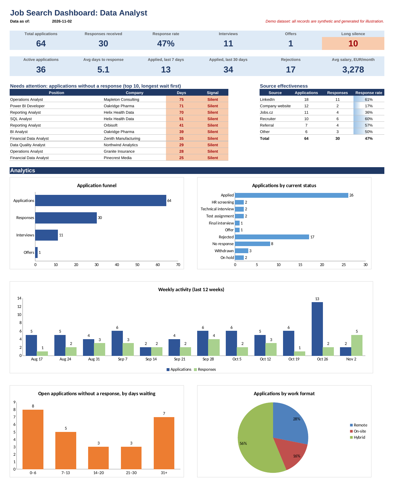

# Job Search Tracker: Excel Dashboard for a Data Analyst Job Search

An Excel workbook that turns a plain log of job applications into a small analytics product: pipeline KPIs, a funnel, weekly activity, source effectiveness and a prioritised follow-up list. Built as a personal pet project and published as a portfolio piece.

> **All data in this repository is synthetic.** Companies, people, e-mail addresses, job links and salaries were generated by `scripts/generate_synthetic_data.py` for demonstration only. Any resemblance to real organisations or persons is coincidental. E-mail addresses use the reserved `example.com` domain.



*Dashboard as of the demo report date (2026-11-02). Screenshot rendered with LibreOffice; Excel styling differs slightly.*

## Why this project

A job search produces data that is rarely analysed: dozens of applications, irregular replies, multi-stage interviews. The tracker answers practical questions:

- How many applications receive a response, and how quickly?
- Which sources (LinkedIn, job boards, recruiters, referrals) actually convert?
- Which applications have gone silent long enough to justify a follow-up?
- Is the weekly application pace steady, and are responses keeping up?

## Workbook structure

| Sheet | Purpose |
|---|---|
| **Dashboard** | 12 KPI tiles, top-10 follow-up list, source effectiveness table, 5 charts |
| **Applications** | Main data table (`tblApplications`): yellow columns are inputs, grey columns are formulas |
| **Calculations** | Aggregations that feed the dashboard and charts; no manual input |
| **Settings** | Thresholds, report date, status flags and drop-down lists |

### Data model (Applications)

| Type | Columns |
|---|---|
| Input | Position, Company, Applied on, Response date, Status, Interview date, Contact person, Contact details, Source, Work format, Location, Salary from, Salary to, Currency, Period, Job link, Notes |
| Calculated | #, Days since applied, Days to response, Signal, Responded, Interviewed, EUR per month, Sort key |

## Business logic

**Status flags.** Each status in *Settings* carries three 0/1 flags (Responded, Closed, Interview). Formulas read the flags through `INDEX/MATCH`, so changing how a status is counted needs no formula edits.

**Signal** (one value per application, evaluated in this order):

| Signal | Rule |
|---|---|
| Closed | Status is flagged as closed (Rejected, No response, Withdrawn) |
| Responded | A response date exists or the status implies a response |
| Silent | No response for ≥ 21 days (configurable) |
| Follow up | No response for ≥ 7 days (configurable) |
| Waiting | Otherwise |

**Salary normalisation.** The midpoint of the range (or the lower bound if no upper bound is given) is converted to EUR at a configurable rate and divided by 12 for yearly figures.

**Follow-up ranking.** The dashboard lists the ten longest-waiting open applications. A helper key `days + ROW()/100000` makes every value unique, so `LARGE` and `MATCH` return a stable order even when several applications share the same age.

**Weekly activity.** A rolling 12-week grid (Monday-based, ending with the current week) counts applications by date applied and responses by response date.

**Report date.** All day counts use `AsOfDate`. Leaving *Settings → Report date override* blank means `TODAY()`; the demo freezes it at 2026-11-02 so the synthetic data always shows the same picture.

## Excel techniques used

- Structured table with calculated columns; named ranges built on structured references (`r_applied = tblApplications[Applied on]`)
- `COUNTIFS`, `INDEX/MATCH`, `LARGE`, `IFERROR`, `WEEKDAY`-based week bucketing
- Data validation: drop-down lists, date checks, response date not earlier than application date
- Conditional formatting: signal colours, upcoming-interview alert, closed rows greyed out, data bars
- Native Excel charts driven by the *Calculations* sheet
- Only functions available since Excel 2010, so the workbook also opens in LibreOffice

## Validation

`scripts/validate_workbook.py` re-implements the business rules in Python and compares the result with the values Excel calculated: every calculated column for all rows, all 12 KPI tiles and the top-10 list. It also detects deliberately altered values. During development the funnel, status, format, source, waiting-time and weekly aggregates were checked the same way, together with edge cases: the exact 7- and 21-day thresholds, missing salary bounds, yearly salaries, blank rows and same-age ties.

## How to use it for a real search

1. Open `Job_Search_Tracker.xlsx` in Excel (2010 or later).
2. In **Settings**, clear the *Report date override* cell so calculations use today's date, and set the *Analysis start date*.
3. In **Applications**, delete the sample rows: select the yellow input columns of the data rows and press *Delete*. Keep the grey formula columns.
4. Enter one row per application. Fill *Response date* and *Interview date* when they happen; keeping the interview date after a rejection preserves the interview in the funnel.
5. Adjust thresholds, statuses, sources and exchange rates in **Settings** as needed.

## Reproducing the demo

```bash
pip install -r requirements.txt
python scripts/generate_synthetic_data.py      # data/synthetic_applications.csv
python scripts/build_workbook.py               # Job_Search_Tracker.xlsx
# open the workbook in Excel once and save it, then:
python scripts/validate_workbook.py Job_Search_Tracker.xlsx
```

The generator is seeded, so the output is identical on every run.

## Repository layout

```
├── Job_Search_Tracker.xlsx          # demo workbook with synthetic data
├── data/
│   └── synthetic_applications.csv   # generated input data
├── docs/
│   └── dashboard.png                # dashboard screenshot
├── scripts/
│   ├── generate_synthetic_data.py   # seeded synthetic data generator
│   ├── build_workbook.py            # builds the workbook (formulas, formats, charts)
│   └── validate_workbook.py         # independent cross-check of calculated values
├── requirements.txt
└── LICENSE
```

## Limitations

- *Status* stores the current stage only; the funnel relies on dates (response, interview) to remember earlier stages.
- Exchange rates are static and must be updated manually.
- The response rate includes very recent applications that have not yet had time to receive a reply.

## License

MIT, see [LICENSE](LICENSE).
